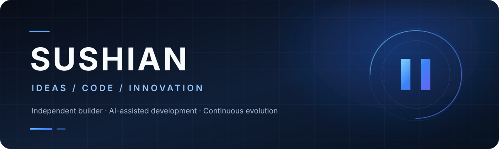

<!-- Local assets only: all profile artwork is stored in this repository. -->

 

**Vibe Coder** &nbsp;·&nbsp; **Independent Builder** &nbsp;·&nbsp; **Tech Enthusiast**

*I turn ideas into useful software through curiosity, experimentation, and code.*

 

&nbsp;

---

## About

I'm an independent developer focused on building practical software and exploring what can be achieved with modern technology.

My workflow blends **AI-assisted development**, problem-solving, and iterative engineering — from the first idea to a working product.

<table>
  <tr>
    <td width="50%">
      <strong>FOCUS</strong> 
      Software · AI · Automation
    </td>
    <td width="50%">
      <strong>APPROACH</strong> 
      Build · Experiment · Improve
    </td>
  </tr>
  <tr>
    <td>
      <strong>INTERESTS</strong> 
      Product thinking · Architecture · Innovation
    </td>
    <td>
      <strong>CURRENTLY BUILDING</strong> 
      Odin Assistant
    </td>
  </tr>
</table>

## Featured Project

**An open-source Forex &amp; Gold market analysis assistant.**

Built around multi-timeframe technical analysis, structured market insights, and decision support.

 

---

**THINK CLEARLY. BUILD BOLDLY. KEEP EVOLVING.**

Driven by curiosity. Defined by what gets built.

